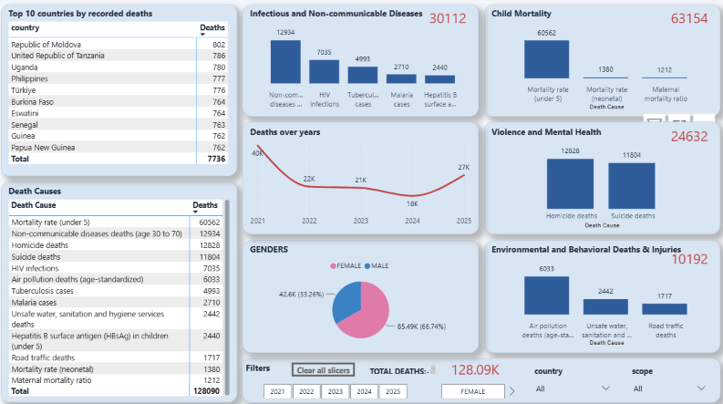
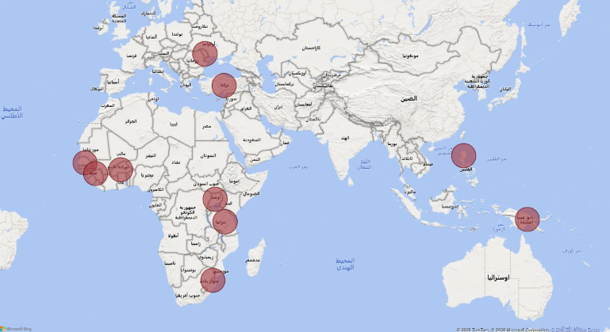

# WHO Health Analysis Dashboard | Power BI

An interactive dashboard exploring health data, mortality patterns, and major causes of death across different countries and years.

This project started as a personal attempt to explore WHO health data and discover what insights could be found through data analysis. I used Power BI to organize the data, explore different health indicators, and turn the findings into an interactive dashboard.

## Dashboard Preview

### Geographic Distribution Map

## 1. Dashboard Overview

The dashboard brings together different health indicators in one place, making it easier to explore and compare the data.

It includes:

- Top 10 countries by recorded deaths.
- Major causes of death.
- Infectious and non-communicable diseases.
- Child and maternal mortality.
- Violence and mental health-related deaths.
- Environmental and behavioral deaths and injuries.
- Death trends from 2021 to 2025.
- Gender distribution.
- Interactive filters for year, gender, country, and scope.

## 2. Key Findings

While exploring the data, I identified several interesting patterns across different health indicators.

| Health Indicator | Recorded Deaths |
|---|---:|
| Under-five Mortality | 60,562 |
| Non-communicable Diseases | 12,934 |
| Homicide | 12,828 |
| Suicide | 11,804 |
| HIV Infections | 7,035 |
| Tuberculosis | 4,993 |

### Additional Observations

| Indicator | Result |
|---|---:|
| Total Recorded Deaths | 128.09K |
| Female Deaths | 66.74% |
| Male Deaths | 33.26% |

**Yearly Trend:**

The dashboard shows a general decline in recorded deaths between 2021 and 2024, followed by an increase in 2025.

**Country Comparison:**

The Republic of Moldova ranks first among the displayed top 10 countries, with 802 recorded deaths.

---.

## 3. Tools & Skills

**Tools Used:**
- Microsoft Power BI
- Power Query

**Skills Practiced:**
- Data Cleaning and Transformation
- Data Analysis
- Data Visualization
- Interactive Dashboard Design
- KPI Development
- Data Storytelling

## 4. Recommendations

Based on the patterns observed in the dashboard, some areas deserve further attention:

- Improving healthcare services for mothers and children.
- Strengthening disease prevention and early detection.
- Increasing awareness and access to mental health services.
- Supporting environmental health and road safety initiatives.
- Continuing to monitor mortality trends across different countries and years.

## 5. Project Files

| File | Description |
|---|---|
| WHO_Health_Analysis.pbix | Power BI dashboard file |
| WHO_Health_Analysis_Dashboard.png | Dashboard screenshot |

## 6. Disclaimer

This project is for learning and portfolio purposes. The findings are based on the available dataset and should be interpreted within its context.

**Project Type:** Personal Project  
**Tool:** Microsoft Power BI  
**Category:** Health Data Analysis

---

# تحليل البيانات الصحية | Power BI

مشروع تفاعلي لاستكشاف البيانات الصحية وتحليل أنماط الوفيات وأبرز أسبابها عبر مجموعة من الدول والسنوات.

بدأ هذا المشروع كمحاولة شخصية لاستكشاف بيانات منظمة الصحة العالمية والتعرف على النتائج التي يمكن الوصول إليها من خلال تحليل البيانات. استخدمت Power BI لتنظيم البيانات واستكشاف المؤشرات الصحية وتحويل النتائج إلى لوحة معلومات تفاعلية.

## 1. نظرة عامة على لوحة المعلومات

تجمع لوحة المعلومات مجموعة من المؤشرات الصحية في مكان واحد، مما يسهل استكشاف البيانات ومقارنتها.

وتشمل:

- أعلى 10 دول من حيث الوفيات المسجلة.
- أبرز أسباب الوفاة.
- الأمراض المعدية وغير المعدية.
- وفيات الأطفال والأمهات.
- الوفيات المرتبطة بالعنف والصحة النفسية.
- الوفيات والإصابات المرتبطة بالعوامل البيئية والسلوكية.
- تطور الوفيات من 2021 إلى 2025.
- توزيع الوفيات حسب الجنس.
- فلاتر تفاعلية حسب السنة والجنس والدولة والنطاق.

## 2. أهم النتائج والتحليلات

أثناء استكشاف البيانات، لاحظت مجموعة من الأنماط والاختلافات بين المؤشرات الصحية.

| المؤشر الصحي | عدد الوفيات المسجلة |
|---|---:|
| وفيات الأطفال دون الخامسة | 60,562 |
| الأمراض غير المعدية | 12,934 |
| جرائم القتل | 12,828 |
| الانتحار | 11,804 |
| الإصابة بفيروس HIV | 7,035 |
| السل | 4,993 |

### ملاحظات إضافية

| المؤشر | النتيجة |
|---|---:|
| إجمالي الوفيات المسجلة | 128.09 ألف |
| وفيات الإناث | 66.74% |
| وفيات الذكور | 33.26% |

**التغير السنوي:**

تُظهر لوحة المعلومات انخفاضًا عامًا في الوفيات المسجلة بين عامي 2021 و2024، تلاه ارتفاع في عام 2025.

**مقارنة الدول:**

جاءت جمهورية مولدوفا في المرتبة الأولى ضمن أعلى 10 دول المعروضة، بعدد 802 حالة وفاة.

## 3. الأدوات والمهارات المستخدمة

**الأدوات:**
- Microsoft Power BI
- Power Query

**المهارات التي طبقتها:**
- تنظيف البيانات وتحويلها.
- تحليل البيانات واستخلاص النتائج.
- تصميم التصورات البيانية.
- تصميم لوحات معلومات تفاعلية.
- إنشاء مؤشرات الأداء.
- عرض البيانات بطريقة واضحة وسهلة الفهم.

## 4. التوصيات

بناءً على الأنماط التي ظهرت أثناء تحليل البيانات، هناك بعض المجالات التي تستحق مزيدًا من الاهتمام:

- تحسين خدمات الرعاية الصحية للأمهات والأطفال.
- تعزيز الوقاية من الأمراض والكشف المبكر عنها.
- زيادة الوعي بالصحة النفسية وتسهيل الوصول إلى خدمات الدعم النفسي.
- الاهتمام بالصحة البيئية وتعزيز السلامة المرورية.
- الاستمرار في متابعة اتجاهات الوفيات ومقارنتها بين الدول والسنوات.

## 5. ملفات المشروع

| الملف | الوصف |
|---|---|
| WHO_Health_Analysis.pbix | ملف لوحة المعلومات بصيغة Power BI |
| WHO_Health_Analysis_Dashboard.png | صورة لوحة المعلومات |

## 6. إخلاء المسؤولية

هذا المشروع مخصص للتعلم وعرض المهارات ضمن ملف الأعمال. وتعتمد النتائج على البيانات المتاحة، لذلك ينبغي تفسيرها في سياق مجموعة البيانات المستخدمة.

**نوع المشروع:** مشروع شخصي  
**الأداة:** Microsoft Power BI  
**مجال المشروع:** تحليل البيانات الصحية

